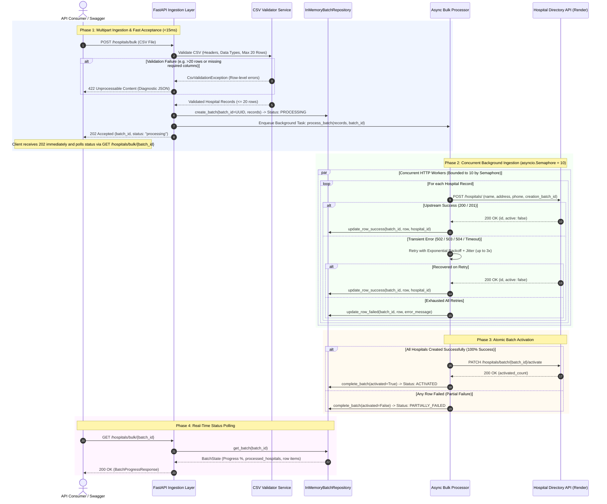
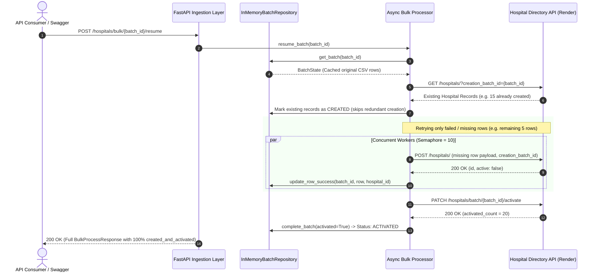
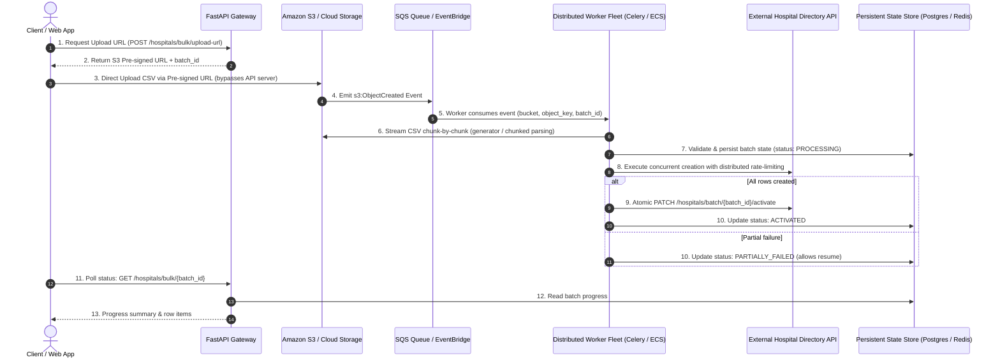

# Hospital Bulk Processing System

A high-performance, asynchronous bulk processing system built with **FastAPI** and **HTTPX** that integrates with the external **Hospital Directory API** (`https://hospital-directory.onrender.com`).

It reliably handles multipart CSV file uploads, validates data formats and constraints, manages unique batch tracking IDs, executes concurrent creation requests with bounded rate-limiting and exponential backoff, and atomically activates batches.

---

## 🏗️ 1. Architecture & System Design

### 1.1 High-Level Design (HLD) Architecture

The diagram below illustrates the end-to-end architecture, showing the decoupled layers from the client entry point to the upstream Render service:

```mermaid
flowchart TB
    subgraph Clients["1. Client Layer"]
        C1["API Consumers / cURL / Scripts"]
        C2["Swagger OpenAPI UI (/docs)"]
    end

    subgraph API["2. FastAPI Ingestion & Controller Layer"]
        R_BULK["routes_bulk.py<br/>• POST /hospitals/bulk (202 Accepted / ?sync=true)<br/>• POST /hospitals/bulk/validate<br/>• POST /hospitals/bulk/{batch_id}/resume<br/>• DELETE /hospitals/bulk/{batch_id}"]
        R_STAT["routes_status.py<br/>• GET /hospitals/bulk/{batch_id} (Poll Progress)<br/>• GET /hospitals/bulk (List Historical Batches)"]
        R_ROOT["routes_ui.py<br/>• GET / (Redirect to /docs)<br/>• GET /health (Health Check Probe)"]
    end

    subgraph Core["3. Core Domain & Orchestration Layer"]
        VAL["CsvValidator<br/>• Stream parsing (DictReader)<br/>• Header schema check (name, address, phone)<br/>• Max 20 rows enforcement<br/>• Whitespace & UTF-8 BOM normalization"]
        PROC["BulkProcessor (Orchestrator)<br/>• Non-blocking background worker dispatch<br/>• Delta resume calculator (upstream diffing)<br/>• Concurrency control (asyncio.Semaphore=10)<br/>• Atomic batch activation coordinator"]
        CLI["HospitalClient (HTTPX AsyncClient)<br/>• Keep-Alive connection pool (50 max, 20 idle)<br/>• Exponential backoff + full jitter (3 retries)<br/>• Non-blocking async HTTP worker calls"]
    end

    subgraph State["4. State & Repository Layer"]
        REPO["InMemoryBatchRepository (Thread-Safe LRU)<br/>• threading.Lock concurrency safety<br/>• Batch metadata & row item tracking<br/>• Real-time progress metrics (percentage, counts)<br/>• Bounded LRU capacity to prevent memory leaks"]
    end

    subgraph Upstream["5. External Hospital Directory API (Render)"]
        EXT_CREATE["POST /hospitals/<br/>(id, active: false, creation_batch_id)"]
        EXT_ACT["PATCH /hospitals/batch/{batch_id}/activate<br/>(Atomic activation -> active: true)"]
        EXT_GET["GET /hospitals/?creation_batch_id={batch_id}<br/>(Query created rows for resume diff)"]
        EXT_DEL["DELETE /hospitals/{hospital_id}<br/>(Rollback batch hospitals)"]
        EXT_HLT["GET /health<br/>(Upstream readiness check)"]
    end

    %% Client Interactions
    C1 -->|1. Multipart CSV Upload| R_BULK
    C1 -->|Poll Progress / Resume / Delete| R_BULK & R_STAT
    C2 -->|Interactive API Testing| API

    %% Ingestion to Validation & Processing
    R_BULK -->|2. Validate CSV| VAL
    VAL -->|Valid Records| R_BULK
    R_BULK -->|3. Register Batch (UUID)| REPO
    R_BULK -->|4. Add Background Task| PROC
    R_BULK -.->|5. Return 202 Accepted (<15ms)| C1

    %% Status Polling
    R_STAT -->|Read Status & Progress| REPO

    %% Core Processing & Concurrency
    PROC -->|Update Row Statuses| REPO
    PROC -->|Concurrent Requests (Semaphore=10)| CLI
    R_ROOT -->|Health Probe| CLI

    %% Outbound HTTP to Render
    CLI -->|POST /hospitals/| EXT_CREATE
    CLI -->|PATCH /activate| EXT_ACT
    CLI -->|GET /hospitals/| EXT_GET
    CLI -->|DELETE /hospitals/| EXT_DEL
    CLI -->|GET /health| EXT_HLT
```

### 1.2 End-to-End Execution Sequence Diagram

The sequence diagram below models the actual execution path: fast non-blocking acceptance (`202 Accepted`), concurrent background processing throttled by `asyncio.Semaphore(10)`, atomic activation on 100% success, and client polling:



> **💡 Synchronous Mode (`?sync=true`)**: Passing `POST /hospitals/bulk?sync=true` bypasses background queuing and awaits the entire pipeline before responding with `200 OK` (useful for synchronous CLI scripts or testing).

### 1.3 Smart Resume Sequence Diagram (Delta Retry)

When a batch partially fails, `POST /hospitals/bulk/{batch_id}/resume` queries upstream to identify which records were already created, skips them, retries only the missing rows, and activates the batch:



---

## 📐 2. Architecture & Design Principles

The codebase is built following clean architecture and **SOLID** design principles, keeping the system lightweight, thread-safe, and focused on the challenge requirements:

* **Separation of Concerns**: Ingestion, validation, upstream HTTP interaction, and state management are decoupled into dedicated service layers.
* **Thread-Safe In-Memory State**: `InMemoryBatchRepository` manages batch metadata, row items, and status transitions with a `threading.Lock` and bounded LRU eviction (configurable capacity) to prevent unbounded memory growth.
* **Dependency Injection**: Services (`BulkProcessor`, `HospitalClient`, `InMemoryBatchRepository`) are supplied via FastAPI dependency providers, enabling effortless unit testing and mocking.
* **Defensive Input Validation**: Streaming CSV parsing via `csv.DictReader` with strict column presence checking, whitespace normalization, BOM handling, and custom `CsvValidationException`.

---

## ⚡ 3. Key Performance & Resilience Features

1. **Bounded Concurrency**: Uses `asyncio.Semaphore(10)` to throttle outbound HTTP calls, preventing downstream 429 rate-limits while achieving **< 1.0s processing time** for 20 records (a **~7x speedup** over naive sequential execution).
2. **HTTP Keep-Alive Connection Pooling**: Configured with `httpx.Limits(max_connections=50, max_keepalive_connections=20)` to reuse TLS/TCP handshakes across concurrent calls.
3. **Exponential Backoff with Full Jitter**: Resilient retry loop (`delay = base * 2^(attempt-1) + jitter`) for transient 502/503/504 errors and network drops. Does not waste retries on 4xx client errors.
4. **Atomic Batch Activation**: Calls `PATCH /hospitals/batch/{batch_id}/activate` strictly when all hospital records in the batch have been verified and created. If any record fails, the batch remains unactivated.
5. **No 413 Payload Too Large Errors**: Uploaded CSV files are inspected directly by the application validator, enforcing the 20-row limit and header schema with standard `400`/`422` validation diagnostics.

---

## 🎁 4. Optional Tasks & Bonus Features Implemented

* **Performance Optimization**: Bounded async execution, keep-alive pooling, and retry backoff.
* **Progress Tracking**: Real-time batch inspection and progress tracking via polling endpoint (`GET /hospitals/bulk/{batch_id}`) and listing endpoint (`GET /hospitals/bulk`).
* **Resume Capability**: `POST /hospitals/bulk/{batch_id}/resume` checks which records already exist upstream, skips completed records, retries failed ones, and activates the batch.
* **Standalone CSV Validation**: `POST /hospitals/bulk/validate` inspects syntax, column headers, empty fields, and row counts before executing bulk operations.
* **Batch Rollback**: `DELETE /hospitals/bulk/{batch_id}` cleans up batches from the upstream directory.
* **Dockerization**: Production-ready multi-stage `Dockerfile` and `docker-compose.yml`.

---

## 📡 5. API Reference

### 1. Bulk Create Hospitals
* **Endpoint**: `POST /hospitals/bulk`
* **Content-Type**: `multipart/form-data`
* **Form Field**: `file` (CSV file with columns: `name,address,phone`)
* **Default Execution**: Returns **HTTP 202 Accepted** immediately (<15ms) and executes processing asynchronously in the background. Clients poll `GET /hospitals/bulk/{batch_id}` for live progress.
* **Synchronous Execution**: Pass `?sync=true` to block until all records are created and batch is activated (**HTTP 200 OK**).

#### Example Background Request (Default - Instant Response):
```bash
curl -X POST "http://localhost:8000/hospitals/bulk" \
  -F "file=@sample_data/valid_hospitals_5.csv"
```

#### Example Synchronous Request (Blocks until Activated):
```bash
curl -X POST "http://localhost:8000/hospitals/bulk?sync=true" \
  -F "file=@sample_data/valid_hospitals_5.csv"
```

#### Example Synchronous / Completed Response (200 OK):
```json
{
  "batch_id": "550e8400-e29b-41d4-a716-446655440000",
  "total_hospitals": 5,
  "processed_hospitals": 5,
  "failed_hospitals": 0,
  "processing_time_seconds": 1.25,
  "batch_activated": true,
  "hospitals": [
    {
      "row": 1,
      "hospital_id": 101,
      "name": "St. Jude Children's Research Hospital",
      "status": "created_and_activated",
      "error": null
    },
    {
      "row": 2,
      "hospital_id": 102,
      "name": "Mayo Clinic Hospital",
      "status": "created_and_activated",
      "error": null
    }
  ]
}
```

---

### 2. Pre-Validate CSV (Bonus)
* **Endpoint**: `POST /hospitals/bulk/validate`
* **Content-Type**: `multipart/form-data`

```bash
curl -X POST "http://localhost:8000/hospitals/bulk/validate" \
  -F "file=@sample_data/invalid_exceed_limit_25.csv"
```

#### Example Response:
```json
{
  "valid": false,
  "total_rows": 25,
  "errors": [
    {
      "row": null,
      "column": null,
      "message": "CSV contains 25 hospital rows, which exceeds the maximum allowed limit of 20 hospitals per batch."
    }
  ],
  "message": "Validation failed with 1 error(s)."
}
```

---

### 3. Resume Failed Batch (Bonus)
* **Endpoint**: `POST /hospitals/bulk/{batch_id}/resume`

```bash
curl -X POST "http://localhost:8000/hospitals/bulk/550e8400-e29b-41d4-a716-446655440000/resume"
```

---

### 4. Poll Batch Progress & Status
* **Endpoint**: `GET /hospitals/bulk/{batch_id}`

```bash
curl "http://localhost:8000/hospitals/bulk/550e8400-e29b-41d4-a716-446655440000"
```

---

### 5. List Historical Batches
* **Endpoint**: `GET /hospitals/bulk`

```bash
curl "http://localhost:8000/hospitals/bulk"
```

---

### 6. Rollback / Delete Batch (Bonus)
* **Endpoint**: `DELETE /hospitals/bulk/{batch_id}`
* Roll back and delete all hospital records associated with the specified batch ID from the upstream directory.

```bash
curl -X DELETE "http://localhost:8000/hospitals/bulk/550e8400-e29b-41d4-a716-446655440000"
```

---

### 7. Service & Upstream Health Check
* **Endpoint**: `GET /health`
* Readiness and liveness probe checking internal health and upstream Render API reachability.

```bash
curl "http://localhost:8000/health"
```

---

## 🚀 6. Getting Started

### Local Development Setup

```bash
# 1. Clone the repository
git clone <repo-url>
cd paribus-hps

# 2. Create and activate virtual environment
python3 -m venv .venv
source .venv/bin/activate

# 3. Install dependencies
pip install -r requirements.txt

# 4. Start local development server
uvicorn main:app --reload --port 8000
```

Access the interactive Swagger OpenAPI documentation at **`http://localhost:8000/docs`** (root **`http://localhost:8000`** automatically redirects to `/docs`).

---

### Docker & Docker Compose

Run the entire application in a container with a single command:

```bash
# Using Docker Compose
docker compose up --build

# Or build and run standalone Docker container
docker build -t paribus-hps .
docker run -p 8000:8000 -e PORT=8000 paribus-hps
```

---

## 🧪 7. Running Tests

The test suite covers unit tests, mocked integration tests, and live upstream tests:

```bash
# Run all unit and mock integration tests
pytest -v

# Run with test coverage report
pytest --cov=app --cov-report=term-missing

# Run live integration test against the deployed Render Hospital Directory API
pytest -v -m live
```

---

## 🌐 8. Deployment to Render

Deploying to Render as a Web Service:

1. Push your repository to GitHub or GitLab.
2. In the Render Dashboard, click **New +** → **Web Service**.
3. Connect your repository and configure:
   - **Environment**: `Python`
   - **Build Command**: `pip install -r requirements.txt`
   - **Start Command**: `uvicorn main:app --host 0.0.0.0 --port $PORT`
   - **Health Check Path** (under Advanced): `/health`
4. Under **Environment Variables**, add:
   - `HOSPITAL_API_BASE_URL` = `https://hospital-directory.onrender.com`
   - `CONCURRENCY_LIMIT` = `10`
   - `MAX_CSV_ROWS` = `20`
   - `REQUEST_TIMEOUT_SECONDS` = `15.0`
   - `MAX_RETRIES` = `3`
5. Click **Deploy Web Service**. Your service will be live in ~2 minutes!

> **💡 Keeping Render Free Tier Active**: Render free-tier instances sleep after 15 minutes of inactivity. You can set up a free monitor (e.g. via [UptimeRobot](https://uptimerobot.com/)) targeting your public `/health` endpoint every 5–10 minutes to prevent sleep.

---

## 🚀 9. Future Production Scaling Architecture & Optimizations (Enterprise & Big Data Scale)

For enterprise scale, multi-gigabyte CSV files (millions of records), or high-concurrency multi-tenant workloads, the architecture evolves from direct multipart ingestion to a **decoupled, event-driven cloud pipeline**:



### Key Architectural Pillars for Scale:

1. **Direct-to-S3 Upload via Pre-signed URLs**:
   - Instead of routing massive CSV payloads through the FastAPI application server (which exhausts server memory and ties up HTTP worker threads), the client requests a short-lived **Pre-signed PUT/POST URL** from the backend.
   - The file streams directly from the client's browser/CLI to **Amazon S3** (or Google Cloud Storage / Azure Blob Storage).

2. **Event-Driven Decoupling (`s3:ObjectCreated`)**:
   - Once the upload completes, S3 automatically triggers an **`s3:ObjectCreated`** event notification.
   - The event routes into an **Amazon SQS** queue (or AWS EventBridge / Apache Kafka topic), completely decoupling file ingestion from processing.

3. **Autonomous Worker Fleet & Memory-Efficient Streaming**:
   - Background worker processes (e.g., Celery, ARQ, Temporal, or AWS ECS/Fargate tasks) consume tasks from the queue.
   - Workers download and stream the CSV **chunk-by-chunk** using generator-based chunked readers (or Polars/PyArrow streaming), processing files of arbitrary size with constant, low RAM usage (`O(1)` memory).

4. **Durable Persistence & Distributed Throttling**:
   - Batch progress and row states are written to a durable database (**PostgreSQL / DynamoDB**).
   - Upstream API rate limits are enforced across multi-node worker clusters using a **distributed Redis token-bucket rate limiter** to prevent downstream 429 errors.

