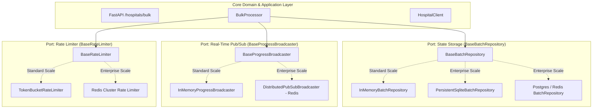
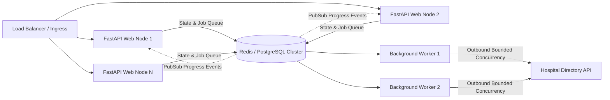

# Enterprise Scaling Architecture Guide (Ports & Adapters)

## 1. Architectural Philosophy: Ports & Adapters (Hexagonal Architecture)

The Hospital Bulk Processing System is built around **loose coupling** and **dependency inversion**. The core ingestion workflow, CSV validator, and API endpoints **never talk directly to concrete infrastructure implementations**. Instead, they interact with clean abstract interfaces (**Ports**).

By swapping the underlying **Adapters** via environment configuration, the application scales from single-node Standard Scale to a multi-replica, distributed Enterprise Scale with **zero code modifications**.

---

## 2. Pluggable Ports & Adapters Matrix

| Architectural Port | Standard Scale Adapter | Enterprise Scale Adapter | How to Switch (Zero Code Changes) |
| :--- | :--- | :--- | :--- |
| **State Storage Port** `BaseBatchRepository` | `InMemoryBatchRepository` (Thread-safe, LRU cache) | `PersistentSqliteBatchRepository` or PostgreSQL/Redis | Set `STORAGE_BACKEND=database` and `DATABASE_URL=sqlite:///./batches.db` (or postgres) |
| **Pub/Sub Port** `BaseProgressBroadcaster` | `InMemoryProgressBroadcaster` (Local instance WebSockets) | `DistributedPubSubBroadcaster` (Redis Pub/Sub topic) | Set `DISTRIBUTED_PUBSUB_ENABLED=true` and `REDIS_URL=redis://...` |
| **Rate Limiter Port** `BaseRateLimiter` | `TokenBucketRateLimiter` (Local memory token bucket) | Distributed Redis Token Bucket | Configured via `GLOBAL_RATE_LIMIT_RPS=50` |
| **Task Queue Port** `Execution Engine` | In-process `asyncio.Semaphore` | Distributed Task Queue (Celery / ARQ / Temporal) | Configured via `EXECUTION_ENGINE=distributed` |

---

## 3. Distributed Enterprise Deployment Topology

When scaled horizontally across multiple cloud compute nodes (e.g. AWS ECS, Kubernetes, GCP Cloud Run):

### Why this design minimizes changes:
1. **No API Route Modifications**: `POST /hospitals/bulk`, `POST /hospitals/bulk/validate`, and `POST /hospitals/bulk/{batch_id}/resume` remain identical.
2. **WebSocket Continuity**: Because `BaseProgressBroadcaster` relays events through Redis, a client connected via WebSocket to `Web Node 1` receives updates even if the batch was processed on `Worker Node 2`.
3. **Upstream Directory Protection**: The `BaseRateLimiter` ensures that 50 worker containers coordinate and never exceed the maximum RPS of the upstream Render API.
4. **Zero-Loss Resilience**: In the event of a worker crash or node eviction, the durable `PersistentSqliteBatchRepository` / PostgreSQL preserves the batch state so the client can resume via `POST /hospitals/bulk/{batch_id}/resume` seamlessly.
